<div align="center">



<br>

<a href="https://github.com/D1ma-coder/ITD-APK-Source/releases"></a>


<a href="https://github.com/D1ma-coder/ITD-APK-Source/fork"></a>

<br><br>

<b>Исходный код Android-приложения <a href="https://итд.com">ИТД</a>, максимально близкий к официальному.</b><br>
<sub>Форкните, допишите немного кода — и у вас свой клиент ИТД.</sub>

<br><br>

<a href="#-зачем-это-нужно">Зачем</a> &nbsp;•&nbsp;
<a href="#-как-сделано">Как сделано</a> &nbsp;•&nbsp;
<a href="#-что-внутри">Что внутри</a> &nbsp;•&nbsp;
<a href="#-как-сделать-свой-мод">Свой мод</a> &nbsp;•&nbsp;
<a href="#-сборка">Сборка</a> &nbsp;•&nbsp;
<a href="#-что-дальше">Что дальше</a>

</div>

<br>

## 📌 О проекте

> [!NOTE]
> Сделал репозиторий, где постарался максимально точно повторить исходники официального приложения ИТД. Проект собирается в Android Studio и работает с тем же сервером, что и оригинал.

<table>
<tr>
<td width="33%" align="center">
<h3>🧬</h3>
<b>Функционально идентичен</b><br>
<sub>те же экраны, запросы к API и поведение, что у версии 1.1.0</sub>
</td>
<td width="33%" align="center">
<h3>🧩</h3>
<b>Готов к модам</b><br>
<sub>понятная структура пакетов, обычный Gradle-проект без магии</sub>
</td>
<td width="33%" align="center">
<h3>🔄</h3>
<b>Следует за обновлениями</b><br>
<sub>каждая версия ИТД — отдельный релиз с исходниками</sub>
</td>
</tr>
</table>

## 🎯 Зачем это нужно

Чтобы вы могли легко **сделать форк** проекта и, добавив немного кода, **сделать мод** на приложение — по сути, свой клиент ИТД на основе официального.

<table>
<tr>
<td>🎨 Своя тема и оформление</td>
<td>🧰 Новые функции и твики</td>
<td>🔕 Свои фильтры ленты</td>
</tr>
<tr>
<td>📊 Расширенная статистика</td>
<td>🌐 Эксперименты с API</td>
<td>📚 Изучение устройства приложения</td>
</tr>
</table>

## 🛠 Как сделано



1. Взял **последнюю версию** ИТД.
2. **Декомпилировал** её.
3. Большую часть **необфусцированных файлов перенёс напрямую** — модели данных, `MainActivity`, `CameraActivity`, push-сервис, ресурсы, иконки, ассеты.
4. **Обфусцированные файлы восстановлены и приведены в порядок с помощью ИИ** — с сохранением функциональной идентичности: тот же API, те же тексты, та же логика.

<details>
<summary><b>🔬 Как проверялась идентичность</b></summary>
<br>

- Все запросы к API (пути, параметры, заголовки, формат JSON) сверены с оригиналом.
- Модели данных проверяются тестом контрактов: имена полей, типы и значения по умолчанию совпадают с оригиналом.
- Тексты интерфейса сравнивались построчно: в проекте есть подавляющее большинство строк оригинала.
- Release-сборка с R8 запускается так же, как оригинальное приложение.

</details>

## 📦 Что внутри

<table>
<tr>
<td valign="top" width="50%">

**📰 Лента и посты**
- Вкладки «Для вас», «Подписки», «Лента кланов», поиск
- Посты с фото, видео, опросами, репостами
- Комментарии, ответы, голосовые сообщения
- Редактор с форматированием и ссылками
- Живое обновление лайков и просмотров

**👤 Профиль и люди**
- Профиль, стена, «Понравилось», подписчики
- Редактирование профиля, пины, баннер-рисовалка
- Блокировки и жалобы

</td>
<td valign="top" width="50%">

**🔔 Уведомления**
- Push через Firebase и поток в реальном времени (SSE)
- Подписка в ответ прямо из уведомлений

**⚙️ Аккаунт и безопасность**
- Вход, регистрация, восстановление пароля, капча
- Вход на компьютере по QR-коду
- Активные сессии, приватность, подписка «ИТД НУКСТА»

**🎃 Сезонный ивент «Хеллоуин»**
- Призраки в постах, посты-оборотни, ночные конфеты
- Портал события, звуки и уведомления

</td>
</tr>
</table>

### 🧱 Стек

<p>


</p>

### 🗂 Структура

```text
app/src/main/java/com/itd/app/
├── data/
│   ├── analytics/     аналитика просмотров и взаимодействий
│   ├── local/         хранение сессии
│   ├── model/         модели API
│   ├── remote/        HTTP-клиент, API, push, поток уведомлений
│   └── repository/    репозитории и общие обновления постов
├── decompose/         стек оверлеев (пост, профиль, портал, баннер)
├── di/                контейнер зависимостей
├── halloween/         сезонный ивент
├── ui/
│   ├── components/    карточка поста, WebView, общие элементы
│   ├── navigation/    оболочка приложения и нижнее меню
│   ├── screens/       экраны
│   └── theme/         цвета и типографика
└── util/              логирование, время, диагностика
```

## 🧪 Как сделать свой мод

```bash
# 1. Сделайте форк кнопкой Fork вверху страницы и склонируйте его
git clone https://github.com/<ваш-логин>/ITD-APK-Source.git
cd ITD-APK-Source

# 2. Поменяйте applicationId, чтобы мод ставился рядом с официальным приложением
#    app/build.gradle.kts → defaultConfig { applicationId = "com.example.itdmod" }

# 3. Пишите код и собирайте
./gradlew :app:assembleDebug
```

> [!TIP]
> С отдельным `applicationId` мод не конфликтует с официальным ИТД из магазина и ставится рядом с ним.

<details>
<summary><b>💡 С чего начать</b></summary>
<br>

| Хочу изменить | Где искать |
|---|---|
| Цвета и тему | `ui/theme/Theme.kt` |
| Карточку поста | `ui/components/PostCard.kt` |
| Нижнее меню | `ui/navigation/ItdBottomBar.kt` |
| Ленту | `ui/screens/feed/` |
| Запросы к серверу | `data/remote/` |
| Обработку уведомлений | `data/remote/PushNotificationService.kt` |

</details>

## 🔨 Сборка

**Нужно:** актуальная Android Studio, JDK 17–21, Android SDK 36.

```bash
./gradlew :app:assembleDebug        # отладочная сборка
./gradlew :app:testDebugUnitTest    # юнит-тесты
```

Отладочная сборка устанавливается рядом с релизной под идентификатором `com.itd.app.debug`.

## 🗺 Что дальше

Постараюсь успевать **переносить каждое обновление** ИТД вовремя. Исходники определённого обновления можно будет скачать на странице **[Релизы](https://github.com/D1ma-coder/ITD-APK-Source/releases)**.

| Версия ИТД | Статус |
|:---:|:---|
| **1.1.0** | ✅ перенесена |
| следующая | ⏳ скоро |

## ⚠️ Дисклеймер

Это неофициальный проект, не связанный с командой ИТД. Название и логотип принадлежат их владельцам. Проект создан в образовательных целях и для разработки сторонних клиентов. Пользуясь модами, соблюдайте правила сервиса.

<div align="center">
<br>

Если проект пригодился — поставьте ⭐ и сделайте форк!

<sub>Сделано с ❤️ для сообщества ИТД</sub>

</div>
